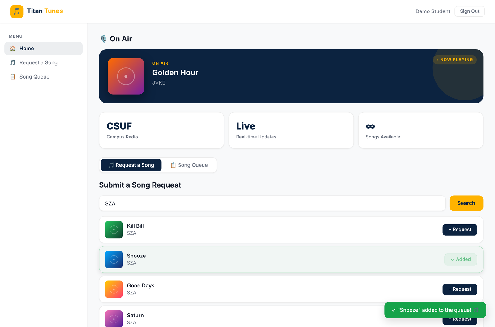
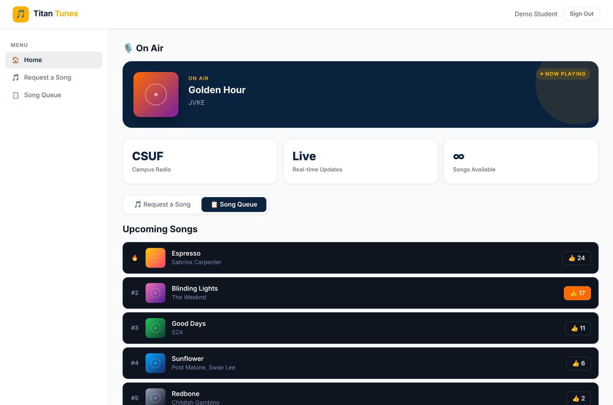
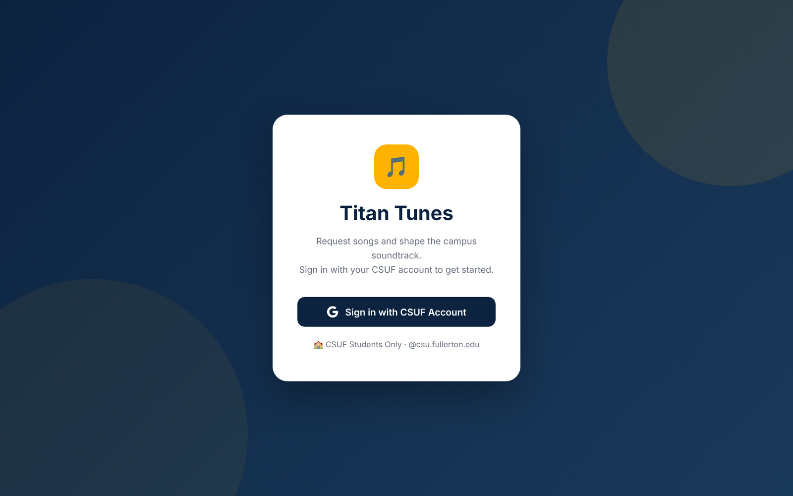
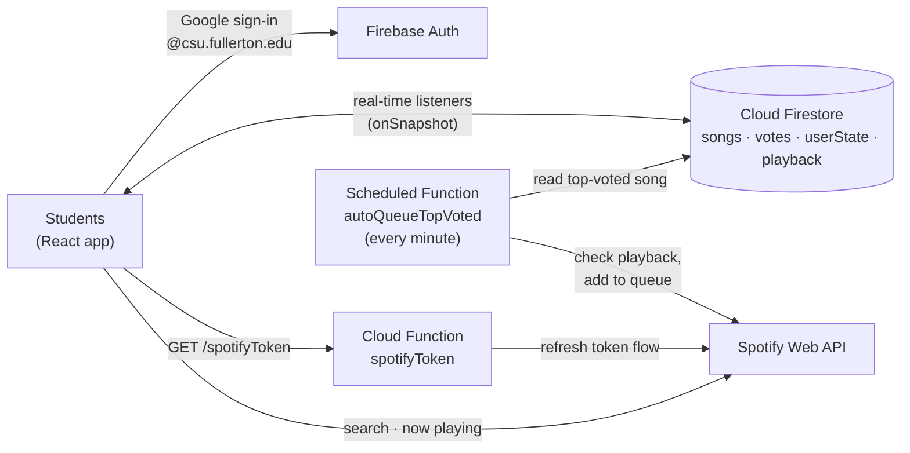

# 🎵 Titan Tunes

**A real-time, crowd-voted song request app for Cal State Fullerton's campus radio.**

Students sign in with their CSUF Google account, search Spotify, request songs, and upvote what plays next. A scheduled cloud function automatically queues the top-voted song on the live Spotify stream right before the current track ends.

Senior capstone project at California State University, Fullerton. Built by a team of five in collaboration with Titan Radio.


---

## Screenshots

| Request a song | Vote on the queue |
|---|---|
|  |  |

<details>
<summary>Sign-in screen</summary>



</details>

> The two app screenshots use sample songs and placeholder album art, because the live app depends on the team's Spotify account and Firebase project.

---

## Features

- **CSUF-only sign-in.** Google authentication restricted to `@csu.fullerton.edu` accounts, enforced in the UI *and* in Firestore security rules.
- **Live "On Air" card.** Shows the song currently playing on the station and updates in real time.
- **Song search and requests.** Search the Spotify catalog and request a track. Duplicate requests are blocked, and each student can have one pending request at a time.
- **Upvoting.** Students vote on pending songs, one vote per student per song. The queue re-ranks instantly for everyone through Firestore listeners.
- **Automatic queueing.** A scheduled Cloud Function checks playback every minute. When the current song is about to end, it pushes the top-voted request to the Spotify queue and frees up that student to request again.

## Architecture



**Why it's built this way:**
- **Spotify credentials never reach the browser.** The client secret and refresh token are stored as Firebase Secrets and used only inside Cloud Functions. The frontend gets a short-lived access token.
- **Firestore is the single source of truth.** Requests, votes, and the now-playing track live in Firestore, so every connected student sees the same queue with no polling or manual refresh.
- **The rules enforce fairness, not just the UI.** Even someone calling Firestore directly can't cheat the system.

## Security rules

[`firestore.rules`](firestore.rules) does the real enforcement:

| Rule | What it prevents |
|---|---|
| All reads and writes require a verified `@csu.fullerton.edu` account | Anyone outside CSUF using the app |
| New requests must start at 0 votes, status `pending`, owned by the requester | Faking vote counts or submitting for someone else |
| A student can't request while they have a pending song | Flooding the queue |
| Vote documents are keyed `uid_trackId` and can't be edited or deleted | Voting twice on the same song |
| Vote counts can only increase, and ownership can't change | Tampering with other songs |

## Tech stack

| Layer | Tools |
|---|---|
| Frontend | React 19, Vite, CSS |
| Auth | Firebase Authentication (Google) |
| Database | Cloud Firestore with real-time listeners |
| Backend | Firebase Cloud Functions v2 (HTTP and scheduled), Node.js |
| Secrets | Firebase Secret Manager |
| External API | Spotify Web API |
| Workflow | Git/GitHub feature branches, Jira tickets (`DS3-xx`), Agile sprints |

## My contributions (Yaser Mohtasebzada)

- **Now Playing component** (DS3-74): built the first version of the live "On Air" card, subscribing to the `playback/current` Firestore document with `onSnapshot` so the current song updates for every user in real time.
- **Song submission frontend** (DS3-45): built the search-and-request flow in `SongSearch.jsx`, including Spotify search results, Firestore duplicate-request detection (DS3-49), per-track loading states, and toast notifications (DS3-48).
- **Vote system integration:** worked on `voteSystem.js` and resolved the merge conflicts when it was combined with teammates' changes.

## Team

| Member | Focus |
|---|---|
| [Kristin Valido](https://github.com/kristinvalido) | Vote system, queue logic, auto-queue timing |
| Nicholas Reeves | Frontend setup, Firebase Functions groundwork, info display |
| Vu Do | Firebase setup, authentication, Cloud Functions |
| [Luke Makishima](https://github.com/LukeMakishima) | Firestore-based Now Playing updates, documentation |
| [Yaser Mohtasebzada](https://github.com/Yaser-MohtasebZada) | Now Playing component, song submission frontend |

The full commit history from the [original team repo](https://github.com/kristinvalido/Data-Science-3) is preserved here, including the feature branches.

## Run it locally

You need Node.js 20+, the Firebase CLI, a Firebase project, and a [Spotify developer app](https://developer.spotify.com/dashboard).

```bash
git clone https://github.com/Yaser-MohtasebZada/Titan-Tunes.git
cd Titan-Tunes
npm install
cp .env.example .env          # then fill in your values
```

1. Replace the config in `src/firebase.js` with your own Firebase project's web config.
2. Store the Spotify credentials as Firebase Secrets:
   ```bash
   firebase functions:secrets:set SPOTIFY_CLIENT_ID
   firebase functions:secrets:set SPOTIFY_CLIENT_SECRET
   firebase functions:secrets:set SPOTIFY_REFRESH_TOKEN
   ```
3. Deploy the functions and rules, then start the app:
   ```bash
   cd functions && npm install && cd ..
   firebase deploy --only functions,firestore:rules
   npm run dev
   ```
